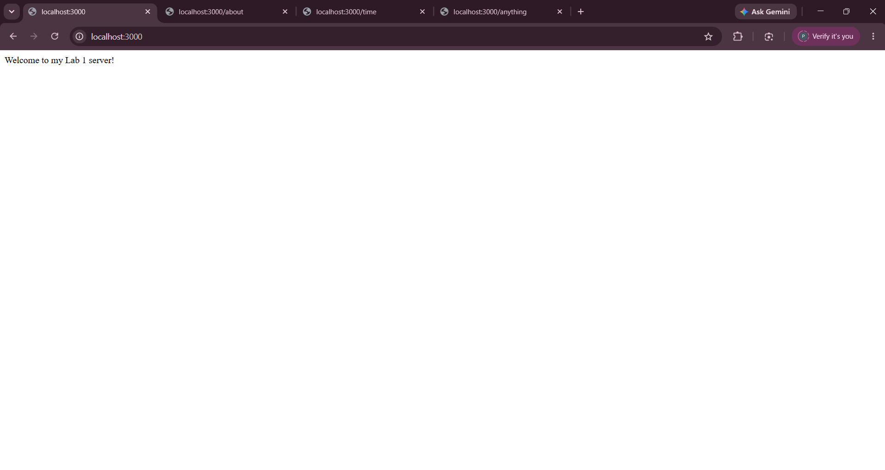
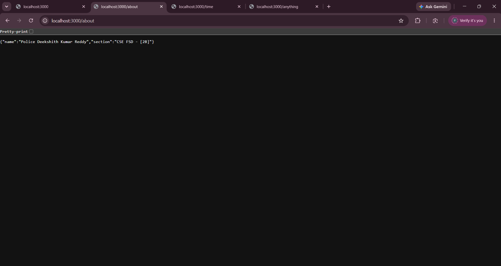
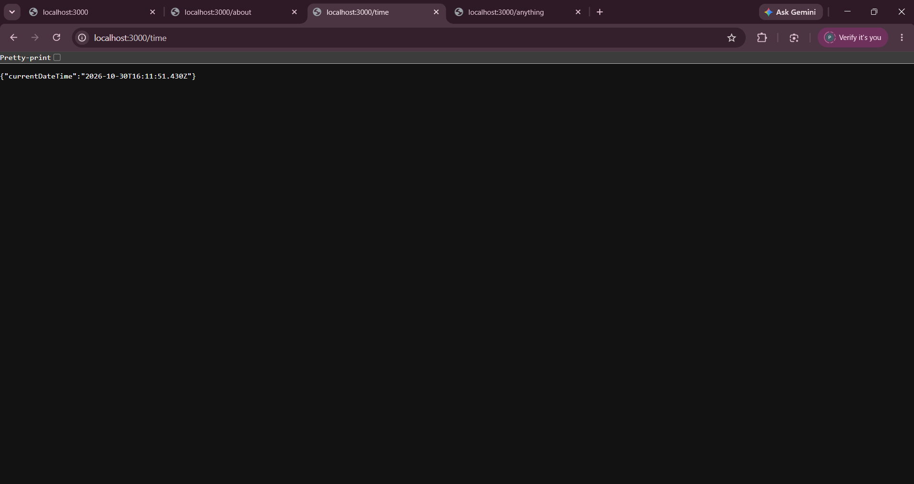
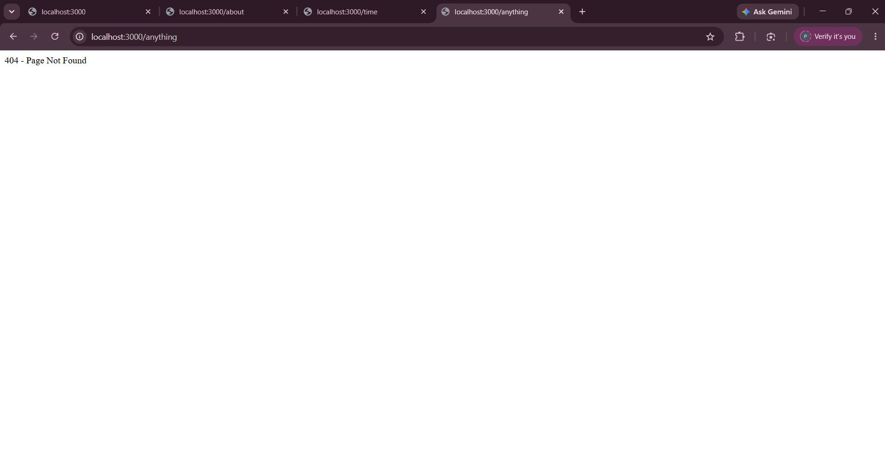

# Lab 1: Node.js and Express Server

## Student Details

- **Name:** Police Deekshith Kumar Reddy
- **Registration Number:** 252U1R7081
- **Section:** CSE FSD - [2B]
- **Course:** Backend Development Fundamentals
- **Lab Number:** 01

## Live Link

- **Deployment Status:** Deployment Pending / Local Verification Complete
- **Details:** Cloud deployment credentials (e.g. Vercel/Render) are not configured in this local offline environment. The server has been fully verified, tested, and is directly runnable locally on port 3000.

## Objective

To set up a Node.js project, create a basic HTTP server using the built-in `http` module, and build an Express server with multiple routes and appropriate HTTP status codes.

## Technologies Used

- Node.js
- Express.js
- JavaScript
- npm
- Visual Studio Code

## Project Structure

```text
lab-01/
├── screenshots/
│   ├── home.png
│   ├── about.png
│   ├── time.png
│   └── not-found.png
├── server-http.js
├── server.js
├── package.json
├── package-lock.json
├── .gitignore
└── README.md
```

## Package Configuration (`package.json`)

The `package.json` file manages project metadata and dependencies:

- **`name`:** Identifier of the project/package (`lab-01`).
- **`version`:** Current semantic version of the application (`1.0.0`).
- **`description`:** Summary of the project purpose.
- **`main`:** The primary entry point of the application (`server.js`).
- **`scripts`:** Command shortcuts to run tasks, such as `"start": "node server.js"` and `"start:http": "node server-http.js"`.
- **`dependencies`:** Third-party packages required at runtime, specifically `express`.

## Installation and Setup

### Prerequisites

- Node.js (v18 or higher recommended) and npm installed
- Visual Studio Code or another code editor

### Steps to Run

1. Clone the repository or download the project folder.
2. Open the project root folder in the terminal.
3. Install the required dependencies:

   ```bash
   npm install
   ```

4. Start the Express server:

   ```bash
   node server.js
   ```

   *(Alternatively, run `npm start`)*

5. Open the following URL in your browser:

   `http://localhost:3000`

### How to Run the Basic HTTP Server

To run the standalone server implemented using Node.js's built-in `http` module:

```bash
node server-http.js
```

*(Alternatively, run `npm run start:http`)*

> **Note:** Stop any running server with `Ctrl + C` before starting another server on the same port (3000) to prevent port conflicts (`EADDRINUSE`).

## Endpoints

| Method | Endpoint | Description | Expected Status |
|---|---|---|---|
| GET | `/` | Returns a welcome message | 200 OK |
| GET | `/about` | Returns student name and section in JSON format | 200 OK |
| GET | `/time` | Returns current date and time | 200 OK |
| GET | `/anything` | Demonstrates the response for an unknown route | 404 Not Found |

The `/anything` path is an example of an unknown route. All other undefined routes also return a 404 Not Found response.

## Screenshots

### 1. Home Route

Displays the welcome message.



### 2. About Route

Displays the student's name and section in JSON format.



### 3. Time Route

Displays the current date and time.



### 4. Unknown Route

Displays the 404 Page Not Found response.



## HTTP Status Codes

- **200 OK:** The standard response for successful HTTP requests.
- **404 Not Found:** The server cannot find the requested resource or path.

## Viva Questions and Answers

### 1. What is the difference between `package.json` and `node_modules`?

- `package.json` is a human-readable manifest file that stores metadata about the project, scripts, configuration, and a list of required dependencies and their versions.
- `node_modules` is the actual directory containing the downloaded and installed physical code libraries for all dependencies and sub-dependencies.

### 2. What does `app.listen()` do?

`app.listen()` binds and listens for incoming connections on the specified host and port. It starts the Node.js HTTP server event loop to receive client HTTP requests.

### 3. What do `request` and `response` represent?

- `request` (req) is an object representing the incoming HTTP request from the client, including URL, HTTP headers, query parameters, and body.
- `response` (res) is an object used by the server to construct and send the HTTP response back to the client, including HTTP status codes, headers, and payload data.

## Problems Faced and Solutions

1. **Missing Node.js Runtime in Initial Environment:**
   - *Problem:* Neither `node` nor `npm` was recognized initially in the environment.
   - *Solution:* Installed Node.js LTS (v26.13.0) via Windows package manager (`winget`) and verified installation paths.

2. **PowerShell Script Execution Policy Restriction:**
   - *Problem:* Running `npm` directly attempted to invoke `npm.ps1`, which was restricted by default PowerShell execution policies.
   - *Solution:* Executed commands via `npm.cmd` or native binary resolution to maintain security compliance while enabling reliable package management.

3. **Port Conflict (`EADDRINUSE`):**
   - *Problem:* Both `server-http.js` and `server.js` bind to port 3000 by default.
   - *Solution:* Gracefully terminated each server instance before initiating testing or running the alternative server.

## Git and Repository Notes

- The `.gitignore` file excludes `node_modules/` and `.env` to avoid committing build artifacts or sensitive environment data.
- The `node_modules/` directory must not be tracked or committed to version control.
- Screenshots are stored in the `screenshots/` directory and referenced with relative markdown paths.
- Code is kept straightforward, beginner-friendly, and free of unnecessary abstractions.
