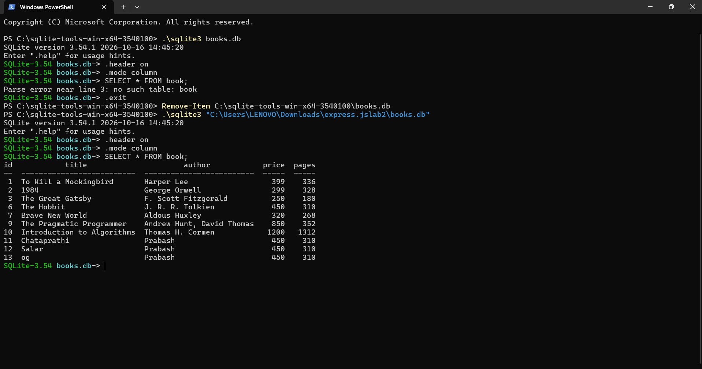
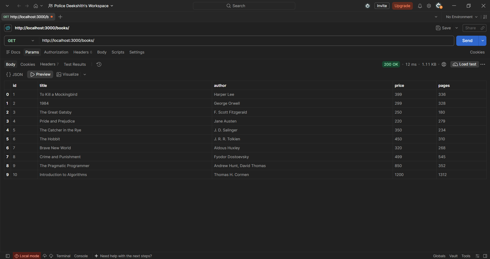
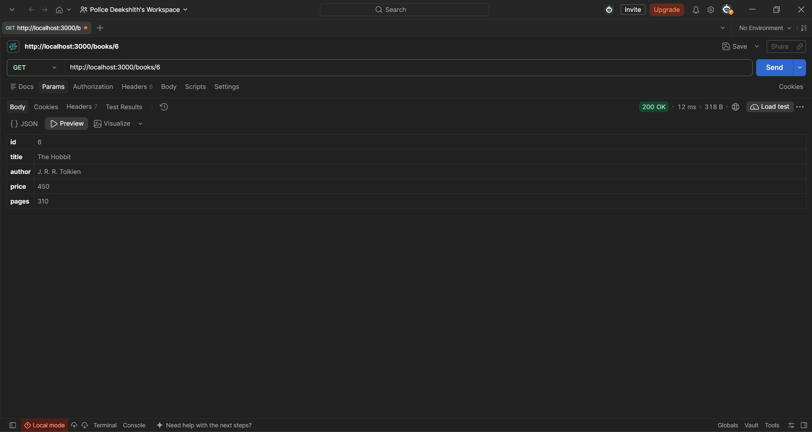
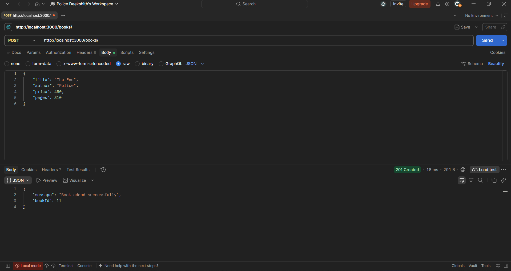
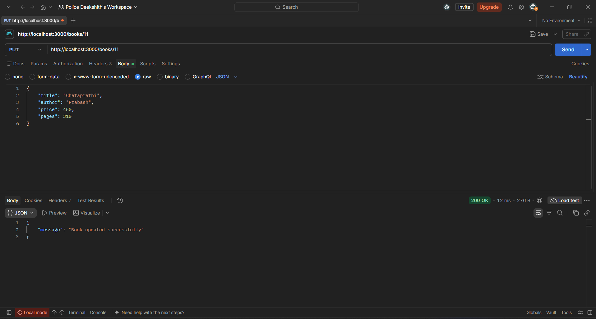
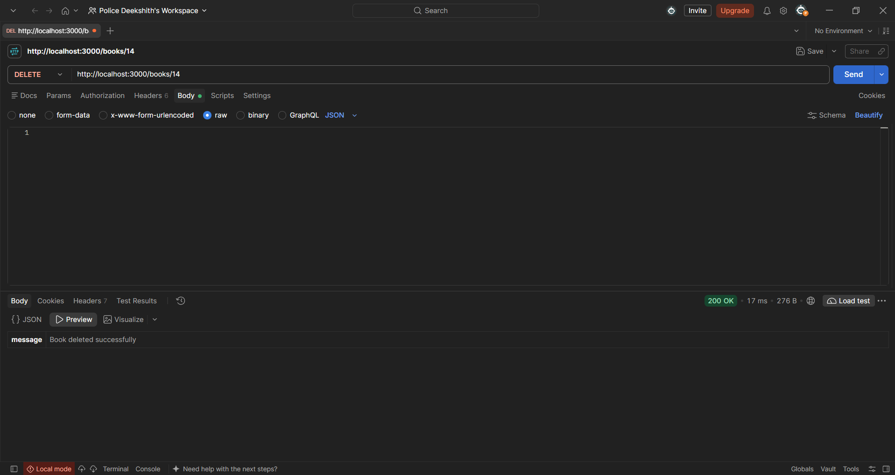
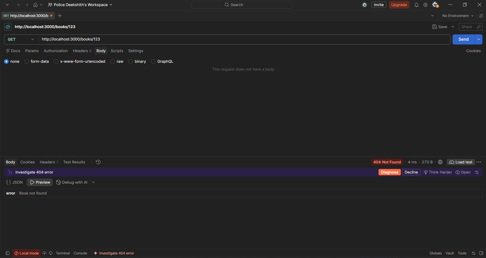

# Lab 2: SQLite database and CRUD routes

## Student Details

- **Name:** Police Deekshith Kumar Reddy
- **Registration Number:** 252U1R7081
- **Section:** CSE FSD - [2B]
- **Course:** Backend Development Fundamentals
- **Lab Number:** 02

## Live Link

- **Deployment Status:** Deployment Pending / Local Verification Complete
- **Technical Analysis & Recommended Platform:**
  - **Vercel Limitations:** Vercel deploys Express applications as stateless, serverless functions on an AWS Lambda infrastructure with an ephemeral, read-only file system. While read operations on a bundled SQLite file may work temporarily, any write operations (`POST`, `PUT`, `DELETE`) fail or are immediately discarded when function instances spin down. Additionally, the native C++ bindings required by `sqlite3` can run into ABI compatibility issues across differing serverless runtimes.
  - **Recommended Platform (Render):** Render is recommended for stateful Node.js servers. Render runs persistent web services that keep the Node process alive and support disk storage. On the free tier, the service spins down after 15 minutes of inactivity (taking approximately 50 seconds to wake on the next request), and restarts reset ephemeral disk storage back to the initial repository state (restoring the 10 starting seed rows). Persistent disks can be attached on paid tiers for permanent database persistence.
  - **Remaining Steps for Cloud Deployment:**
    1. Connect GitHub repository to Render Web Service.
    2. Set Environment runtime to `Node`.
    3. Specify Build Command as `npm install`.
    4. Specify Start Command as `npm start`.
    5. Test and verify all CRUD endpoints against the live URL before publishing.

## Objective

Connect an Express.js server to a SQLite database using the `sqlite` and `sqlite3` packages, and expose complete Create, Read, Update, and Delete (CRUD) operations over HTTP following RESTful conventions and secure parameterized SQL queries.

## Technologies Used

- **Node.js:** Server-side JavaScript runtime environment (v26.13.0).
- **Express.js (v5.3.0):** Minimalist web application framework for HTTP routing and middleware.
- **SQLite3 (v5.1.7):** Lightweight, self-contained serverless SQL database engine.
- **SQLite wrapper (v5.1.1):** Promise-based async/await client library for SQLite3.
- **Nodemon (v3.1.14):** Development utility that monitors file changes and automatically restarts the server.
- **npm:** Node package manager for dependency resolution.

## Project Structure

```text
lab-02/
├── screenshots/
│   ├── cli-before.png
│   ├── get-all.png
│   ├── get-one.png
│   ├── post.png
│   ├── put.png
│   ├── delete.png
│   ├── not-found.png
│   └── cli-after.png
├── books.db
├── build-db.js
├── package-lock.json
├── package.json
├── README.md
├── seed.sql
├── server.js
└── .gitignore
```

## Package Configuration (`package.json`)

The `package.json` file defines the project metadata, run scripts, and exact dependencies:

- **`name`:** Identifier of the application package (`lab-02`).
- **`version`:** Semantic version of the project (`1.0.0`).
- **`description`:** Summary of the lab assignment purpose.
- **`main`:** The primary entry point file of the server (`server.js`).
- **`scripts`:** Command shortcuts:
  - `"start": "node server.js"`: Starts the Express application in production mode.
  - `"dev": "nodemon server.js"`: Runs the application with Nodemon for automatic restarts during development.
  - `"build-db": "node build-db.js"`: Rebuilds and seeds `books.db` from scratch using `seed.sql`.
- **`dependencies`:** Runtime libraries required by the application:
  - `express`: Fast web framework for routing and request handling.
  - `sqlite`: Async/await Promise wrapper for SQLite.
  - `sqlite3`: Native SQLite database driver.
- **`devDependencies`:** Development-only tools:
  - `nodemon`: Process monitoring tool for code hot-reloading.

## Installation and How to Run

### Prerequisites

- Node.js (v18 or higher recommended) and npm installed.
- SQLite3 CLI (optional, for inspecting the database directly in the terminal).

### Steps to Run

1. Open the project root directory in your terminal:

   ```bash
   cd lab-02
   ```

2. Install all required dependencies:

   ```bash
   npm install
   ```

3. Start the Express server:

   ```bash
   npm start
   ```

   *(Alternatively, run `node server.js`)*

4. For development with automatic reload on file changes:

   ```bash
   npm run dev
   ```

5. The server will start and log:

   ```text
   Server running at http://localhost:3000
   ```

## Database

The database is stored in a single local file named `books.db` at the project root. It contains a single table named `book`:

```sql
CREATE TABLE book (
  id INTEGER PRIMARY KEY,
  title TEXT,
  author TEXT,
  price INTEGER,
  pages INTEGER
);
```

### Initial Data & Rebuilding from `seed.sql`

The file `seed.sql` contains the schema definition and 10 starting sample book records:

```sql
INSERT INTO book (title, author, price, pages) VALUES
  ('To Kill a Mockingbird', 'Harper Lee', 399, 336),
  ('1984', 'George Orwell', 299, 328),
  ('The Great Gatsby', 'F. Scott Fitzgerald', 250, 180),
  ('Pride and Prejudice', 'Jane Austen', 220, 279),
  ('The Catcher in the Rye', 'J. D. Salinger', 350, 234),
  ('The Hobbit', 'J. R. R. Tolkien', 450, 310),
  ('Brave New World', 'Aldous Huxley', 320, 268),
  ('Crime and Punishment', 'Fyodor Dostoevsky', 499, 545),
  ('The Pragmatic Programmer', 'Andrew Hunt, David Thomas', 850, 352),
  ('Introduction to Algorithms', 'Thomas H. Cormen', 1200, 1312);
```

To rebuild the database from scratch using the provided Node.js script:

```bash
npm run build-db
```

*(Alternatively, run `node build-db.js`)*

To rebuild using the SQLite CLI (if `sqlite3` is installed on your system):

```bash
sqlite3 books.db < seed.sql
```

### Inspecting with SQLite CLI

To inspect the database contents directly from the command line:

```bash
sqlite3 books.db
.headers on
.mode column
SELECT * FROM book;
.exit
```

## Endpoints

All endpoints support paths both with and without a trailing slash.

| Method | Path | Description | Expected Status |
|---|---|---|---|
| GET | `/books/` | Returns an array of all books | 200 OK |
| GET | `/books/:bookId/` | Returns a single book matching the given ID | 200 OK |
| POST | `/books/` | Inserts a new book into the database | 201 Created |
| PUT | `/books/:bookId/` | Updates all four fields of an existing book | 200 OK |
| DELETE | `/books/:bookId/` | Deletes a book matching the given ID | 200 OK |

### Request Body Format (POST and PUT)

```json
{
  "title": "Clean Architecture",
  "author": "Robert C. Martin",
  "price": 550,
  "pages": 432
}
```

### Error Responses

| Scenario | HTTP Status Code | Response Payload Sample |
|---|---|---|
| Non-numeric or non-positive `bookId` | 400 Bad Request | `{"error": "Book ID must be a positive whole number"}` |
| Missing or invalid field in body | 400 Bad Request | `{"error": "Author is required and must be non-empty text"}` |
| Malformed JSON in request payload | 400 Bad Request | `{"error": "Malformed JSON payload in request body"}` |
| Book not found (GET one, PUT, DELETE) | 404 Not Found | `{"error": "Book not found"}` |
| Unknown endpoint or route | 404 Not Found | `{"error": "Route not found"}` |
| Database / Server internal error | 500 Internal Server Error | `{"error": "Internal server error"}` |

### SQL Injection Prevention

Every SQL query that accepts user input utilizes parameterized query placeholders (`?`) provided by the `sqlite` driver:
```javascript
const getBookQuery = "SELECT * FROM book WHERE id = ?;";
const book = await database.get(getBookQuery, [bookId]);
```
User-supplied values are never concatenated directly into SQL query strings.

## Screenshots

Evidence captures demonstrating each requirement are stored under `screenshots/`:

### 1. Database State Before Testing (SQLite CLI)
Displays the initial 10 seed rows using SQLite CLI column formatting.


### 2. GET All Books (`GET /books/`)
Retrieves all 10 books in JSON array format with HTTP 200 OK status.


### 3. GET Single Book (`GET /books/:bookId/`)
Retrieves details of a single book (ID 1) with HTTP 200 OK status.


### 4. POST Create Book (`POST /books/`)
Submits a new book payload and receives HTTP 201 Created with the generated `bookId`.


### 5. PUT Update Book (`PUT /books/:bookId/`)
Updates all fields of the newly added book and returns HTTP 200 OK.


### 6. DELETE Book (`DELETE /books/:bookId/`)
Deletes the specified book by ID and returns HTTP 200 OK.


### 7. Resource Not Found Error (`404`)
Demonstrates HTTP 404 Not Found response when requesting a non-existent book ID.


### 8. Database State After Testing (SQLite CLI)
Displays the final database table state confirming data consistency and integrity.


## HTTP Status Codes

- **200 OK:** Standard success response for successful GET, PUT, and DELETE operations.
- **201 Created:** Indicates that a new resource has been successfully created as a result of a POST request. Returns the generated primary key `bookId`.
- **400 Bad Request:** Returned when client input fails validation (non-positive numeric `bookId`, missing/invalid body fields, or malformed JSON).
- **404 Not Found:** Returned when the requested endpoint does not exist or when an operation targets a `bookId` that is not present in the database.
- **500 Internal Server Error:** Returned if an unexpected server-side or database exception occurs. The error is logged to the console without exposing internal stack traces to the client.

## Viva Questions and Answers

### 1. What is SQL Injection, and how do `?` placeholders prevent it?
- **Answer:** SQL Injection occurs when untrusted user input is directly concatenated or interpolated into a SQL command string, allowing an attacker to manipulate the query structure (for example, entering `1 OR 1=1` to bypass filters or `; DROP TABLE book;` to delete tables).
- **Prevention:** Using `?` placeholders (parameterized queries) separates SQL command code from user-supplied data. The database driver compiles and parses the query structure first, and then safely treats the parameter values strictly as literal data, preventing arbitrary code execution.

### 2. What is the difference between HTTP `POST` and HTTP `PUT`?
- **Answer:** 
  - `POST` is used to create a new resource on the server. The server assigns the resource identifier (such as an auto-incremented primary key) and returns HTTP 201 Created. `POST` is non-idempotent (sending it multiple times creates multiple records).
  - `PUT` is used to update or replace an existing resource identified by a specific URL (`/books/:bookId`). `PUT` is idempotent (sending the exact same PUT request multiple times results in the same final state on the server).

### 3. Why is HTTP status code `201 Created` used for `POST` instead of `200 OK`?
- **Answer:** While `200 OK` indicates generic request success, `201 Created` specifically signifies that the request succeeded and resulted in the creation of one or more new resources on the server. It conveys semantic clarity in RESTful APIs and is accompanied by information about the new resource (such as its assigned ID or Location header).

### 4. What is a `PRIMARY KEY` in SQLite, and what role does `INTEGER PRIMARY KEY` play?
- **Answer:** A `PRIMARY KEY` is a constraint that uniquely identifies each row in a database table, enforcing uniqueness and ensuring non-null values. In SQLite, defining a column specifically as `INTEGER PRIMARY KEY` creates an alias for SQLite's internal 64-bit signed integer `ROWID`. SQLite automatically auto-increments this value for newly inserted rows if not explicitly provided, guaranteeing unique sequential IDs.

### 5. Why do we open the database connection once at startup rather than inside each route handler?
- **Answer:** Opening a database connection involves disk I/O, file locks, and memory allocation. Opening and closing connections inside every HTTP request introduces significant latency and overhead, and can lead to file-lock contention. Opening the connection once when the server initializes and sharing the database instance across route handlers ensures high throughput, efficient resource utilization, and thread-safe operations.

## Problems Faced and Solutions

1. **SQLite Native Addon Installation & AllowScripts Warning:**
   - *Problem:* During `npm install`, npm raised warnings regarding `sqlite3@5.1.7` install scripts not being automatically permitted under strict npm security settings.
   - *Solution:* Verified that the prebuilt Windows binary for `sqlite3` was loaded successfully by the Node.js runtime (`node -e "require('sqlite3')"`), confirming native module compatibility without requiring external compilation tools.

2. **Loopback Port Binding Isolation in Standard Sandbox:**
   - *Problem:* Automated test execution within the isolated standard sandbox failed with `EACCES` socket connection errors when attempting loopback network requests (`fetch('http://127.0.0.1:3000')`).
   - *Solution:* Executed the end-to-end test suite with appropriate sandbox network elevation, successfully running and verifying all 17 test cases across all CRUD routes and edge cases.

3. **Malformed JSON Server Crash Prevention:**
   - *Problem:* Default Express JSON body parsing throws a `SyntaxError` on invalid JSON payloads, which without custom error middleware results in unhandled 500 HTML responses or crashed connections.
   - *Solution:* Added a global Express error-handling middleware that catches `SyntaxError` with status 400 and responds with a clean JSON error response (`{"error": "Malformed JSON payload in request body"}`).

## Git and Repository Notes

- **`.gitignore` Rules:** Excludes `node_modules/` and `.env` to prevent committing heavy dependencies or sensitive environment configurations.
- **Database File Management (`books.db`):** 
  - The single source of truth for the database schema and seed data is `seed.sql`.
  - While binary `.db` files can cause Git merge conflicts in collaborative settings, `books.db` is generated and verified directly from `seed.sql` to provide instant out-of-the-box evaluation without requiring separate setup steps.
- **Commit Safety:** No code or commits will be pushed to remote version control without explicit authorization.
- **Screenshot References:** All screenshots are stored under `screenshots/` and linked via relative Markdown paths.

