# Lab 3: REST API, query parameters, validation, debugging

**Name:** Police Deekshith Kumar Reddy
**Registration Number:** 252U1R7081
**Section:** CSE FSD - 2B
**Course:** Backend Development Fundamentals
**GitHub Username:** policedeekshith2006-ai
**GitHub Repository:** https://github.com/policedeekshith2006-ai/express.js-lab1

## Live Link

https://vercel.com/policedeekshith2006-7927s-projects/express-js-lab3

If the service is hosted on a free plan it may sleep after a period without traffic, so the first request can be slow. Free plans usually do not keep files between restarts, so books added, changed or deleted through the live link may be lost and the database goes back to its 12 starting rows.

## Objective

Turn the Lab 2 routes into a clean REST API that supports search, sorting, pagination and a price filter, validates its input, returns the correct status code every time, and answers all errors in one JSON format. The lab also includes a debugging exercise on four common errors.

## How to Run

Requirements: Node.js and npm. No environment variables are required. The server reads `PORT` if it is set and uses 3000 otherwise.

```
cd lab-03
npm install
npm start
```

To restart automatically while developing:

```
npm run dev
```

To run the validation checks (no server needed):

```
npm test
```

Packages: `express`, `sqlite`, `sqlite3` (pinned to 5.1.7) and `nodemon` (development only).

The database file is `books.db` with one table: `book(id INTEGER PRIMARY KEY, title TEXT, author TEXT, price INTEGER, pages INTEGER)`. To rebuild it with the 12 starting books run `sqlite3 books.db < seed.sql`.

## Project Structure

| File | Purpose |
| --- | --- |
| `app.js` | Express server, routes, error handling, start-up |
| `lib/validators.js` | Checks query parameters, ids and request bodies |
| `lib/errors.js` | `HttpError` class that carries a status code |
| `test/validators.test.js` | Automatic checks for the validation rules |
| `seed.sql` / `books.db` | Table definition and the starting data |
| `lab-03.postman_collection.json` | 30 Postman requests with automatic checks |

## Endpoints

Endpoints are nouns (`/books`); the HTTP method states the action.

| Method | Path | Description | Success status |
| --- | --- | --- | --- |
| GET | `/books/` | List books with search, sorting, pagination and price filter | 200 |
| GET | `/books/:bookId/` | Get one book by id | 200 |
| POST | `/books/` | Add a book from the JSON body | 201 |
| PUT | `/books/:bookId/` | Replace all fields of an existing book | 200 |
| DELETE | `/books/:bookId/` | Delete a book | 200 |

### Query parameters for GET /books/

| Parameter | Meaning | Default | Allowed values |
| --- | --- | --- | --- |
| `search_q` | Partial, case-insensitive match on the title (`LIKE`) | empty (matches all) | any text |
| `order_by` | Column to sort by | `id` | `id`, `title`, `author`, `price`, `pages` |
| `order` | Sort direction | `ASC` | `ASC`, `DESC` |
| `limit` | Number of books to return | 10 | whole number, 1 to 100 |
| `offset` | Number of books to skip | 0 | whole number, 0 or more |
| `min_price` | Lowest price to include | 0 | whole number, 0 or more |
| `max_price` | Highest price to include | 2147483647 | whole number, 0 or more |

Example: `/books/?search_q=the&min_price=300&max_price=500&order_by=price&order=DESC&limit=5&offset=0`

**How the SQL stays safe.** Every value from the client reaches SQLite through a `?` placeholder. Column names and `ASC`/`DESC` cannot be placeholders, so `order_by` is looked up in a fixed object of allowed columns and `order` is compared with `ASC`/`DESC`; anything else returns 400. The characters `%` and `_` in `search_q` are escaped, so they are searched as plain text and not as `LIKE` wildcards. Results are ordered by the chosen column and then by `id`, so books with the same price or title always come back in the same order, which keeps pagination stable.

### Request body for POST and PUT

```
{
  "title": "Book title",
  "author": "Author name",
  "price": 450,
  "pages": 304
}
```

`title` and `author` must be non-empty text. `price` and `pages` must be whole numbers, 0 or more. A price sent as text (even `"500"`) is rejected.

### Responses and status codes

Every error has the same shape: `{ "message": "..." }`.

| Situation | Status |
| --- | --- |
| Book created | 201 |
| Read, update or delete succeeded | 200 |
| Bad input: missing or invalid body field, bad id, bad query parameter, malformed JSON | 400 |
| Book id not found, or unknown route | 404 |
| Unexpected server error | 500 |

## Postman Tests

`lab-03.postman_collection.json` has 30 requests, each with automatic checks on the status code and the message. Import it into Postman, set the collection variable `baseUrl` (default `http://localhost:3000`, or the live URL) and use **Run collection**. The create request saves the new id in `newBookId`, which the update, read and delete requests after it use.

### Success cases

| # | Test | Request | Expected status |
| --- | --- | --- | --- |
| 01 | GET all books (defaults, limit 10) | `GET /books/` | 200 |
| 02 | GET one book | `GET /books/3/` | 200 |
| 03 | Search by title (search_q=the) | `GET /books/?search_q=the` | 200 |
| 04 | Sort by price descending | `GET /books/?order_by=price&order=DESC&limit=5` | 200 |
| 05 | Pagination (limit=3, offset=3) | `GET /books/?limit=3&offset=3` | 200 |
| 06 | Price range (min_price=300, max_price=450) | `GET /books/?min_price=300&max_price=450` | 200 |
| 07 | All filters together | `GET /books/?search_q=o&min_price=250&max_price=500&order_by=pages&order=DESC&limit=3&offset=1` | 200 |
| 08 | SQL injection text in search is harmless | `GET /books/?search_q=%27%20OR%201%3D1%20--` | 200 |
| 09 | POST create a book | `POST /books/` | 201 |
| 10 | PUT update the new book | `PUT /books/{{newBookId}}/` | 200 |
| 11 | GET the updated book | `GET /books/{{newBookId}}/` | 200 |
| 12 | DELETE the new book | `DELETE /books/{{newBookId}}/` | 200 |

### Failure cases

| # | Test | Request | Expected status |
| --- | --- | --- | --- |
| 13 | GET a book that does not exist | `GET /books/999/` | 404 |
| 14 | GET with a non-numeric id | `GET /books/abc/` | 400 |
| 15 | GET after delete returns 404 | `GET /books/{{newBookId}}/` | 404 |
| 16 | DELETE the same book again | `DELETE /books/{{newBookId}}/` | 404 |
| 17 | PUT a book that does not exist | `PUT /books/999/` | 404 |
| 18 | POST missing title | `POST /books/` | 400 |
| 19 | POST missing author | `POST /books/` | 400 |
| 20 | POST non-numeric price | `POST /books/` | 400 |
| 21 | POST negative price | `POST /books/` | 400 |
| 22 | POST malformed JSON | `POST /books/` | 400 |
| 23 | PUT with an invalid body | `PUT /books/1/` | 400 |
| 24 | Invalid order_by | `GET /books/?order_by=hack` | 400 |
| 25 | Invalid order | `GET /books/?order=SIDEWAYS` | 400 |
| 26 | limit is zero | `GET /books/?limit=0` | 400 |
| 27 | limit is not a number | `GET /books/?limit=abc` | 400 |
| 28 | Negative offset | `GET /books/?offset=-1` | 400 |
| 29 | min_price greater than max_price | `GET /books/?min_price=900&max_price=100` | 400 |
| 30 | Unknown route | `GET /shelves/` | 404 |

## Screenshots

### Search by title

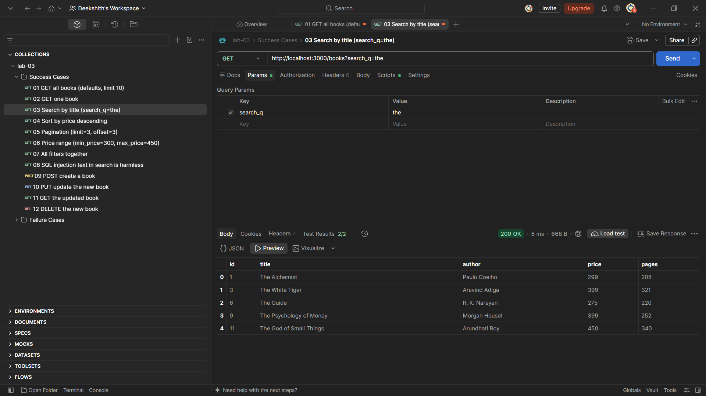

### Sort by price, descending

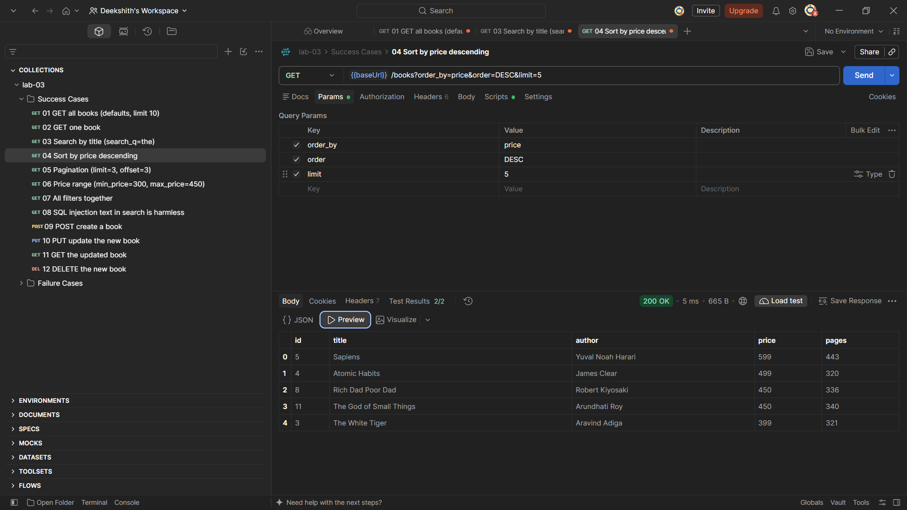

### Pagination

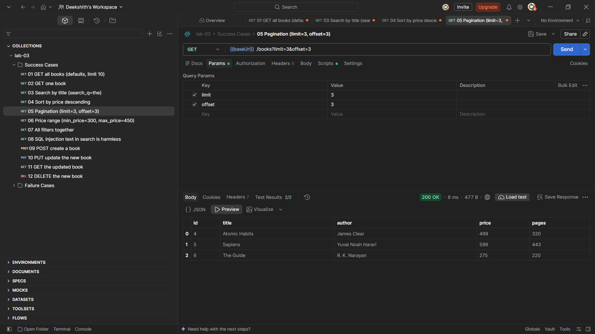

### Price range filter

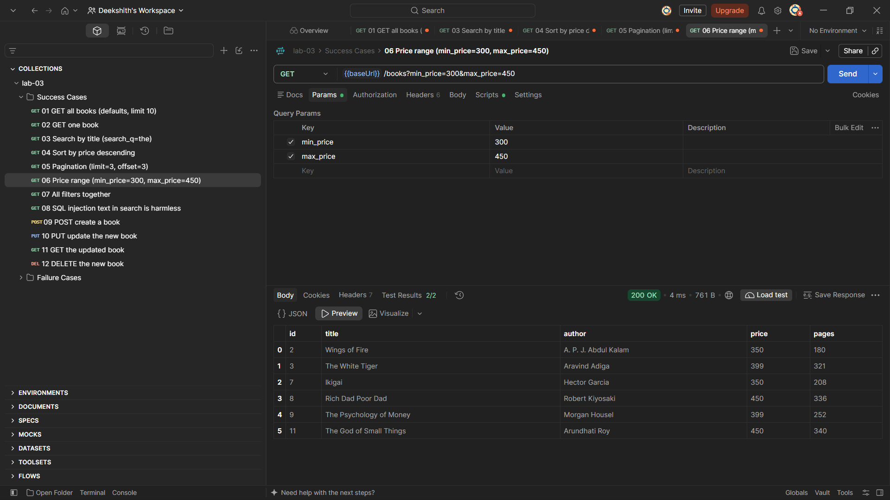

### POST creates a book (201)

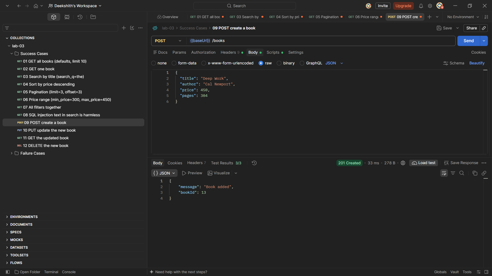

### PUT updates a book (200)

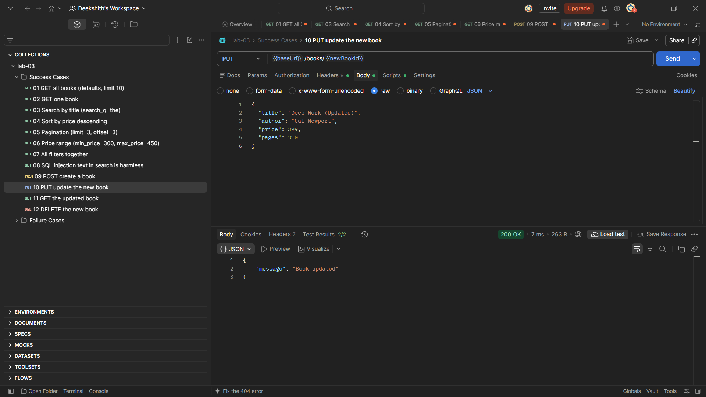

### DELETE removes a book (200)

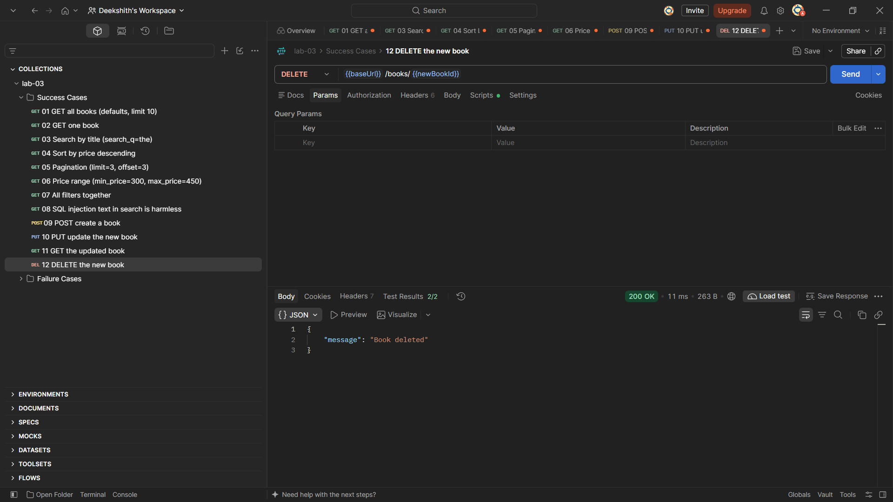

### Validation error: missing title (400)

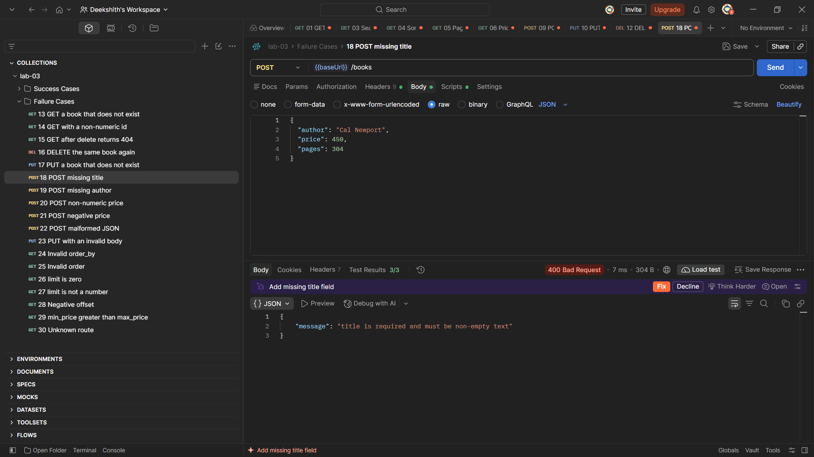

### Validation error: non-numeric price (400)

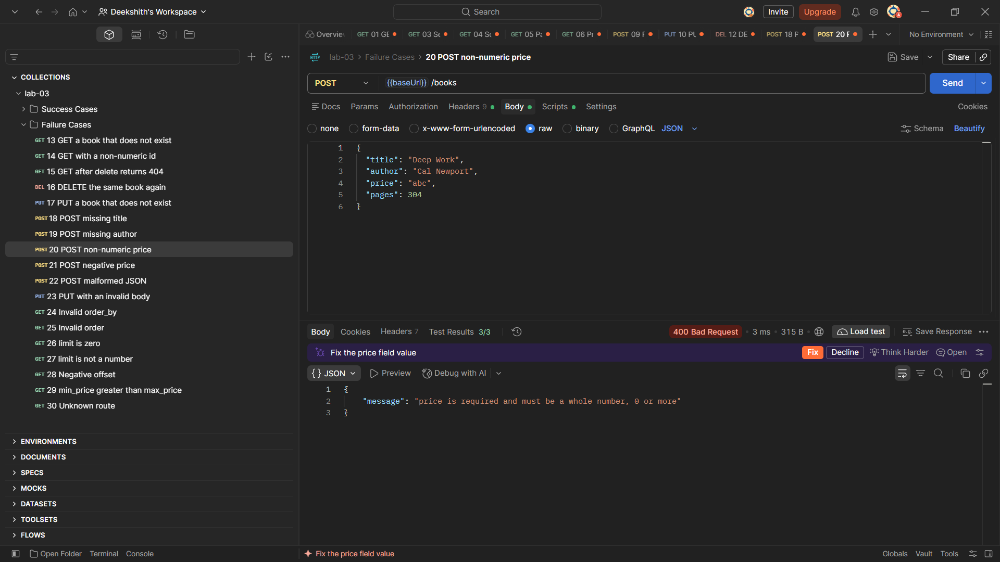

### Book not found (404)

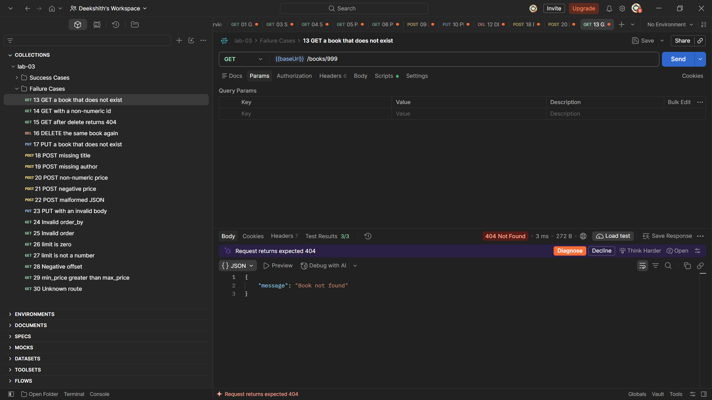

### All 30 Postman tests passing

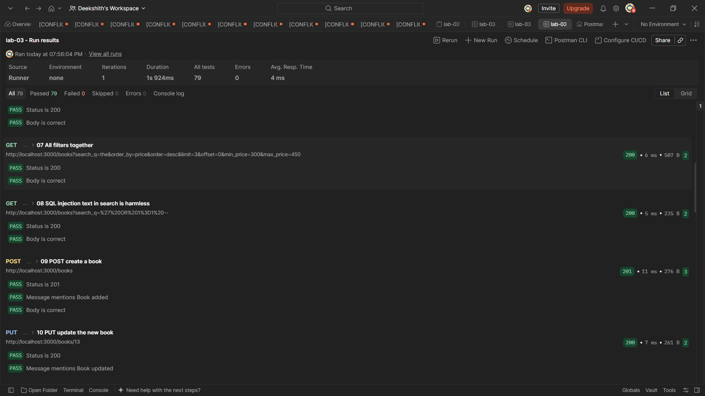

## Debugging Exercise

The faculty gave a broken version of the project. The four errors I fixed:

| Error | Message I saw | Cause | Fix |
| --- | --- | --- | --- |
| Port conflict (EADDRINUSE) | `Error: listen EADDRINUSE: address already in use :::3000` | I had already run `npm start` in another terminal and forgot to stop it, so the port was taken when I started a second instance. | Closed the first terminal and ran `npm start` again. The server came up on port 3000 normally. |
| Wrong import path | `Error: Cannot find module './validators'` followed by a stack trace pointing to `app.js` line 7. | The import was written as `require('./validators')` instead of `require('./lib/validators')`, so Node looked for the file in the root folder where it does not exist. | Changed the path back to `'./lib/validators'` and the server started without errors. |
| Table name typo (no such table) | `SQLITE_ERROR: no such table: books` logged to the console and the API returned `500 Internal Server Error`. | The SQL query said `FROM books` (plural) but the actual table created by `seed.sql` is called `book` (singular). | Changed `FROM books` to `FROM book` in the GET `/books/` route and the query worked correctly. |
| Missing await | The `GET /books/` route returned an empty object `{}` instead of the list of books. | The `await` keyword was removed from `db.all(...)`, so the route received a pending Promise instead of the actual rows and sent it as an empty JSON object. | Added `await` back before `db.all(...)`. Because the handler is already declared `async`, this was the only change needed. |

## Notes

Problems faced and how I solved them:

- When I first ran `npm start` after cloning, the server crashed immediately with `SQLITE_CANTOPEN: unable to open database file`. I did not realise the `books.db` file needed to be created first. I fixed it by running `sqlite3 books.db < seed.sql` to build the database from the seed file, after which `npm start` worked and all 12 books were returned by `GET /books/`.
